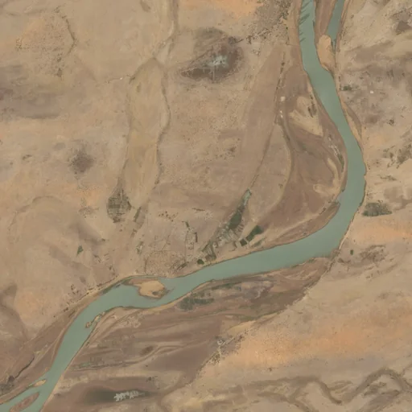
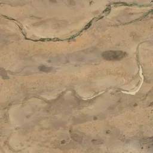
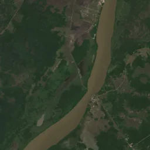
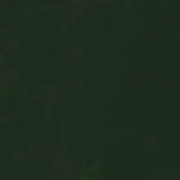
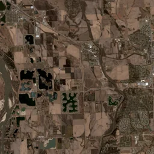
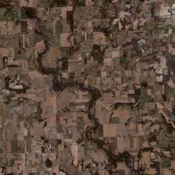
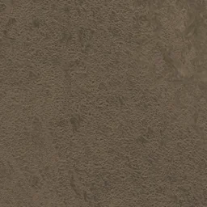

<!-- TODO before publishing: arXiv link (hero button + BibTeX), public code / keep-list URLs,
     author list and affiliations (copied from the previous version of this page). -->

  

  

    <a href="#overview">Overview</a>
    <a href="#idea">Idea</a>
    <a href="#method">Method</a>
    <a href="#protocol">Protocol</a>
    <a href="#results">Results</a>
    <a href="#selection">What is kept</a>
    <a href="#s2naip">S2-NAIP</a>
    <a href="#efficiency">Cost</a>
    <a href="#citation">Cite</a>
  

  <!-- ============================== HERO ============================== -->
  <header class="gs-hero" id="gs-hero">
    <canvas class="gs-hero-canvas" aria-hidden="true"></canvas>
    

    

      
<i></i>arXiv preprint &middot; 2026

      <h1 class="gs-title">GeoSelect</h1>
      
Less Is More: Semantic Curation of Earth Observation Data for Self-Supervised Learning

      
Pretrain on <b>1%</b> of a global Sentinel-2 archive, and get <em>better</em> representations than with all of it.

      

        <a href="/">Guillaume Astruc</a> &middot; <a href="https://ngonthier.github.io/">Nicolas Gonthier</a> &middot; <a href="https://www.umr-lastig.fr/clement-mallet/">Clement Mallet</a> &middot; <a href="https://loiclandrieu.com/">Loic Landrieu</a>
      

      
LASTIG, Univ Gustave Eiffel, IGN, ENSG &nbsp;|&nbsp; CNES &nbsp;|&nbsp; LIGM, ENPC, IP Paris

      

        <!-- TODO: arXiv link -->
        <a class="gs-btn gs-btn-primary" href="#" target="_blank" rel="noopener">
          <svg viewBox="0 0 24 24" aria-hidden="true"><path d="M14 2H6a2 2 0 0 0-2 2v16a2 2 0 0 0 2 2h12a2 2 0 0 0 2-2V8z"/><path d="M14 2v6h6M8 13h8M8 17h5"/></svg>Paper</a>
        <!-- TODO: public code URL -->
        <a class="gs-btn" href="https://github.com/gastruc/Dedup" target="_blank" rel="noopener">
          <svg viewBox="0 0 24 24" aria-hidden="true"><path d="m16 18 6-6-6-6M8 6l-6 6 6 6"/></svg>Code</a>
        <a class="gs-btn" href="#efficiency">
          <svg viewBox="0 0 24 24" aria-hidden="true"><path d="M3 7h18M3 12h18M3 17h12"/></svg>Curated subsets</a>
        <a class="gs-btn" href="#citation">
          <svg viewBox="0 0 24 24" aria-hidden="true"><path d="M7 7h4v4H7zM13 7h4v4h-4zM7 11c0 3-1 5-3 6M13 11c0 3-1 5-3 6"/></svg>BibTeX</a>
      

    

    

      Major-TOM Core-S2L2A
      2,238,687
      tiles in the archive
    

    <a class="gs-scroll" href="#overview" aria-label="Scroll to overview"></a>
  </header>

  <!-- ============================== OVERVIEW ============================== -->
  <section class="gs-section" id="overview">
    
Overview

    <h2 class="gs-reveal">A hundred times less data. Better representations.</h2>
    

      

        Earth-observation foundation models are pretrained on huge satellite archives with substantial redundancy:
        spatial autocorrelation and vast homogeneous regions such as oceans, ice sheets, deserts and closed forests.
        These archives are usually sampled with hand-designed geographic or metadata rules, and rarely curated
        <em>semantically</em>.
      

      

        <b>GeoSelect</b> is a simple, training-free curation method. In a single pass over the features of a frozen EO
        foundation model, it selects a fixed-size subset that is diverse at two levels: <b>across</b> observations, and
        <b>within</b> each observation. Pretraining on the 1% it keeps beats pretraining on the whole archive, and the same recipe
        <a href="#s2naip">transfers to a regional, multi-temporal archive of 302M images</a>.
      

    

    

      

1<small>%</small>

of Major-TOM kept &asymp;22k of 2.24M tiles

      

<small>+</small>2.4

points in classification vs. the full archive

      

<small>+</small>2.2

mIoU in segmentation vs. the full archive

      

100<small>&times;</small>

less storage and transfer 21&nbsp;TB &rarr; 0.2&nbsp;TB

    

    

      

        

          <h3>Every curation strategy, at the same 1% budget</h3>
          
Mean GEO-Bench linear-probe score relative to pretraining on the full archive.

        

        

          <button role="tab" aria-selected="true" data-k="all">All 10 tasks</button>
          <button role="tab" aria-selected="false" data-k="cls">Classification</button>
          <button role="tab" aria-selected="false" data-k="seg">Segmentation</button>
        

      

      

        <i class="c-geo"></i>Geographic prior
        <i class="c-meta"></i>Metadata stratification
        <i class="c-sem"></i>Semantic curation
        <i class="c-ours"></i>GeoSelect
      

      

      
Each subset keeps 1% of Major-TOM (&asymp;22k tiles, 0.2&nbsp;TB of 21&nbsp;TB). A ViT-B is pretrained from scratch with MAE on each subset under the same compute budget, then evaluated frozen by linear probing on 5 classification and 5 segmentation tasks. The zero line is the same model pretrained on all 2.2M tiles.

    

  </section>

  <!-- ============================== IDEA ============================== -->
  <section class="gs-section gs-alt" id="idea">
    
The idea

    <h2 class="gs-reveal">Two kinds of redundancy.</h2>
    

      

        
&asymp;

        

          <h4>Global diversity, across observations</h4>
          
Large archives contain many observations with essentially the same content. Keeping all of them spends the
          budget twice on the same thing. GeoSelect penalises observations that are already represented by a richer one.

        

      

      

        
U

        

          <h4>Local diversity, within each observation</h4>
          
At Sentinel-2 resolution, forests, deserts or fields can look nearly uniform over 10&times;10&nbsp;km. Such
          tiles give a weak self-supervised signal: two crops of them look alike, and masked regions are easy to inpaint.

        

      

    

    

      <figure class="gs-trip gs-reveal">
        

          
          kept
          local diversity: 84th pct.
        

        

          

            
            &asymp;
            cos 0.995 to kept near-duplicate
          

          

            
            U
            local diversity: 2nd pct. uniform
          

        

        <figcaption>Desert</figcaption>
      </figure>
      <figure class="gs-trip gs-reveal">
        

          
          kept
          local diversity: 98th pct.
        

        

          

            
            &asymp;
            cos 0.991 to kept near-duplicate
          

          

            
            U
            local diversity: 3rd pct. uniform
          

        

        <figcaption>Forest</figcaption>
      </figure>
      <figure class="gs-trip gs-reveal">
        

          
          kept
          local diversity: 96th pct.
        

        

          

            
            &asymp;
            cos 0.995 to kept near-duplicate
          

          

            
            U
            local diversity: 19th pct. uniform
          

        

        <figcaption>Cropland</figcaption>
      </figure>
    

    
Real Major-TOM tiles. <b class="t-keep">Kept</b> by GeoSelect at 1%; <b class="t-drop">discarded</b>: <b>&asymp;</b> near-duplicate of the kept tile (global redundancy), <b>U</b> similar content but internally uniform (local redundancy). Cosines are between UniverSat embeddings; percentiles are of local diversity over the archive.

  </section>

  <!-- ============================== METHOD ============================== -->
  <section class="gs-section" id="method">
    
Method

    <h2 class="gs-reveal">Measure both diversities. Select under a budget.</h2>
    

      Each observation is embedded once by a frozen EO foundation model (UniverSat) into \(T\) patch tokens; their mean is its
      global embedding \(f_i\). GeoSelect outputs <em>observation identifiers only</em>: the subset can then pretrain any
      architecture, with any objective, and even another sensor.
    

    <!-- Step 1: local diversity -->
    

      

        
1

        <h3>Local diversity: how much the patch tokens vary</h3>
        
We measure the dispersion of the patch tokens with a diagonal approximation of the MCR&sup2; coding rate. Each feature is
        normalised by its typical variation across the archive, \(\epsilon_d\).

        
\[ L_i = \frac{1}{2}\sum_{d=1}^{D}\log\!\left(1+\frac{\sigma_{i,d}^2}{\epsilon_d^2}\right) \]

        
\(\sigma_{i,d}^2\): variance of feature \(d\) over the tokens of observation \(i\); \(\epsilon_d\): median of \(\sigma_{j,d}\) over the archive.

        
Drag the slider across the archive: uniform water, sand and closed canopy give near-constant tokens; fields,
        rivers, reservoirs, coastlines and relief give varied ones.

      

      

        

          

            

              
              
              

              imagepatch tokens
            

            

              
              
              

              imagepatch tokens
            

          

          

            
Percentile of \(L_i\) in the archive: <b id="gs-spec-p">0.5</b>

            

              

              <input type="range" min="0" max="7" step="1" value="0" aria-label="Percentile of local diversity">
            

            
0.510255075909799.5

          

          
Token maps: UniverSat patch tokens (240&nbsp;m patches), normalised by \(\epsilon_d\), centred on each tile's mean token and projected on three principal components with one shared colour scale.

        

      

    

    <!-- Step 2: global diversity -->
    

      

        
2

        <h3>Global diversity: distance to a richer look-alike</h3>
        
We partition the global embeddings into semantic clusters with \(k\)-means and compare observations within a
        cluster. Like SemDeDup, each observation is compared with those that precede it in an ordering. Unlike SemDeDup,
        which orders by distance to the cluster centroid, we order by <b>decreasing local diversity</b>:

        
\[ G_i = 1-\max_{j:\;c(j)=c(i),\;L_j>L_i}\cos\left(f_i,f_j\right) \]

        
When two observations show essentially the same content, the less locally diverse one gets a small \(G_i\). Run the
        toy cluster with both orderings to see which member of each look-alike pair survives.

      

      

        

          

            

              <button role="tab" aria-selected="false" data-k="sdd">SemDeDup order</button>
              <button role="tab" aria-selected="true" data-k="geo">GeoSelect order</button>
            

            <button class="gs-ghost" data-act="replay" aria-label="Replay"><svg viewBox="0 0 24 24" aria-hidden="true"><path d="M3 12a9 9 0 1 0 3-6.7L3 8M3 3v5h5"/></svg>Replay</button>
          

          <svg class="gs-toy-svg" viewBox="0 0 600 400" role="img" aria-label="Toy semantic cluster in embedding space"></svg>
          

            

              <i class="dot-s"></i><i class="dot-l"></i>size = local diversity \(L_i\)
              <i class="ring-keep"></i>kept
              <i class="link"></i>closest earlier observation
            

            

          

          
Toy illustration (synthetic 2-D cluster, Euclidean distance in place of cosine). Both orderings keep the same number of points; the ordering decides which member of each look-alike pair is kept.

        

      

    

    <!-- Step 3: allocation -->
    

      

        
3

        <h3>Allocate the budget across clusters</h3>
        
Clusters full of near-duplicates should receive fewer slots than clusters of distinct observations. We reuse the
        SemDeDup redundancy \(m_i\) (closest earlier observation, centroid ordering) and pick one global threshold \(\tau_B\)
        such that exactly \(B\) observations pass it. Each cluster's budget is its count of passing observations:

        
\[ B_c = \bigl|\{\, i : c(i)=c,\; m_i\le\tau_B \,\}\bigr|,\qquad \textstyle\sum_c B_c = B \]

        
The real clusters on the right are paired by content: one receives a single slot for hundreds of near-identical
        tiles, its look-alike keeps 18% to 56% of its tiles. Over a third of the budget goes to the tenth of clusters with the largest share.

      

      

        

          

            <button role="tab" aria-selected="true" data-k="0">Sea &middot; coasts</button>
            <button role="tab" aria-selected="false" data-k="1">Ice &middot; relief</button>
            <button role="tab" aria-selected="false" data-k="2">Rainforest &middot; rivers</button>
            <button role="tab" aria-selected="false" data-k="3">Sand &middot; desert coasts</button>
          

          

            

              

              

              <canvas class="gs-waffle" aria-hidden="true"></canvas>
              

            

            

              

              

              <canvas class="gs-waffle" aria-hidden="true"></canvas>
              

            

          

          
Real clusters of the 1% GeoSelect run. Each square is one tile of the cluster; lit squares are its budget \(B_c\). Below: left, the single retained tile and four discarded ones; right, five random members, <b class="t-keep">kept</b> or <b class="t-drop">discarded</b>.

        

      

    

    <!-- Step 4: select -->
    

      
4

      

        <h3>Select the most diverse observations of each cluster</h3>
        
Both diversities are combined into a single score, each term scaled by its interquartile range over the archive.
        Each cluster then keeps its \(B_c\) observations with the highest \(S_i\).

        
\[ S_i = \frac{\log G_i}{\operatorname{IQR}(\log G)} + \frac{L_i}{\operatorname{IQR}(L)} \]

      

      

        
redundancy \(m_i\) decides <b>how many</b> tiles each cluster keeps

        
score \(S_i\) decides <b>which</b> tiles represent it

        
no training no labels, no reference data, one pass over frozen features

      

    

  </section>

  <!-- ============================== PROTOCOL ============================== -->
  <section class="gs-section gs-alt" id="protocol">
    
Evaluation protocol

    <h2 class="gs-reveal">Judge a subset by the model it trains.</h2>
    
Curation is evaluated independently of the representation used for selection: every method picks a
    subset of the <em>same</em> archive, a new model is pretrained <em>from scratch</em> on it with the same recipe and step budget,
    and its frozen features are probed on downstream tasks.

    

      

        
<svg viewBox="0 0 48 48" aria-hidden="true"><circle cx="24" cy="24" r="17"/><path d="M7 24h34M24 7c-6 5-6 29 0 34M24 7c6 5 6 29 0 34M10 15h28M10 33h28"/></svg>

        <h4>Archive</h4>
        
Major-TOM Core-S2L2A: 2,238,687 single-date Sentinel-2 tiles of 10&times;10&nbsp;km, every landmass and coastline.

      

      
<i></i><i></i><i></i>

      

        
<svg viewBox="0 0 48 48" aria-hidden="true"><path d="M8 10h32l-12 15v11l-8 4V25z"/></svg>

        <h4>Curation</h4>
        
Each method keeps the same budget (1% unless stated). Only tile identifiers move on: no curation feature reaches pretraining.

      

      
<i></i><i></i><i></i>

      

        
<svg viewBox="0 0 48 48" aria-hidden="true"><rect x="9" y="9" width="30" height="30" rx="4"/><path d="M15 15h6v6h-6zM27 15h6v6h-6zM15 27h6v6h-6zM27 27h6v6h-6z"/></svg>

        <h4>Pretraining from scratch</h4>
        
ViT-B with MAE (also DINOv2 and LeJEPA): 180k steps &times; 256 crops for <em>every</em> subset. Small subsets are simply revisited more often.

      

      
<i></i><i></i><i></i>

      

        
<svg viewBox="0 0 48 48" aria-hidden="true"><path d="M24 6v36M8.4 15l31.2 18M8.4 33l31.2-18M19 8l5 5 5-5M19 40l5-5 5 5"/></svg>

        <h4>Frozen linear probing</h4>
        
GEO-Bench, 5 classification and 5 segmentation tasks, best probe selected on validation.

      

    

    

      
ClassificationSo2SatBigEarthNetForestNetEuroSATPV4GER

      
SegmentationCashewChesapeakeSA CropNeonTreePV4GER

    

  </section>

  <!-- ============================== RESULTS ============================== -->
  <section class="gs-section" id="results">
    
Results

    <h2 class="gs-reveal">Better than the full archive, and than every heuristic.</h2>
    
Uniformly sampling 1% of the archive loses 0.9 points in classification and 2.2 mIoU in segmentation.
    Targeted curation closes or reverses this gap, and GeoSelect gives the best mean on both task families.

    

      

        

          <h3>GEO-Bench, task by task</h3>
          
First row: full-archive pretraining. Other rows: difference with it. Shaded columns: means over the five tasks of each family. Bold: best of each column at 1%.

        

      

      
<table class="gs-table" id="gs-table"></table>

      
Classification: accuracy (BigEarthNet: &micro;F1); segmentation: mIoU. SemDeDup is budget-controlled. The official subset (Core-S2L2A-249k, 11%) does not match the budget and is shown for reference.

    

    

      

        

          <h3>Across SSL objectives</h3>
          
Gain over full-archive pretraining when a ViT-B is pretrained with DINOv2 or LeJEPA on the same 1% subsets as MAE.

        

        
<i class="c-sem"></i>UniverSat SemDeDup<i class="c-ours"></i>GeoSelect

        

        
View-based objectives gain even more than MAE: +3.4 points in classification with both (MAE: +2.4), consistent with crops of locally diverse tiles containing varied content.

      

      

        

          <h3>Applied to radar</h3>
          
MAE on Sentinel-1: full archive vs. 1% subsets selected by GeoSelect from Sentinel-1 embeddings or from co-registered Sentinel-2 embeddings.

        

        

          GeoSelect on S1 or S2
          <i></i>
          1% Sentinel-1 pretraining
        

        

        
Both 1% subsets beat the full Sentinel-1 archive on reBEN-S1 with 100&times; less data. Optical embeddings remain useful for radar curation, while the target modality's own embeddings give the larger gain at this budget.

      

    

    

      

        

          <h3>Local diversity explains most of the gain over SemDeDup</h3>
          
Gain over the full archive, MAE, 1% budget. Same clusters and cluster budgets for the last two rows.

        

        
<i class="c-cls"></i>Classification<i class="c-seg"></i>Segmentation

      

      

      

        

          
Share of the selection in the less locally diverse half of the archive

          
SemDeDup<i></i>24%

          
GeoSelect<i></i>5%

        

        

          
Geographic regions covered, relative to SemDeDup

          
Top \(L_i\) overall<i></i>55%

          
GeoSelect<i></i>93%

        

        

          
Distance to the nearest kept tile of the same cluster, relative to SemDeDup

          
Local ranking<i></i>41%

          
GeoSelect<i></i>61%

        

      

      
Ranking by \(L_i\) within the same cluster budgets is on par with GeoSelect here, but keeps near-duplicates when both are locally diverse: at nearly identical local diversity and coverage, the global term \(G_i\) pushes the nearest kept neighbour 50% farther. Explicitly penalising redundancy matters most for multi-temporal archives.

    

  </section>

  <!-- ============================== SELECTION ============================== -->
  <section class="gs-section gs-alt" id="selection">
    
What gets kept

    <h2 class="gs-reveal">Coastlines, rivers and relief. Not open ocean.</h2>

    

      

        

          <h3>Where the 1% comes from</h3>
          
Every tile retained at a 1% budget, over the Major-TOM footprint.

        

        

          <button role="tab" aria-selected="true" data-k="random">Random</button>
          <button role="tab" aria-selected="false" data-k="urban">Urban, top-%</button>
          <button role="tab" aria-selected="false" data-k="geoselect">GeoSelect</button>
        

      

      

        

        

        

        

        

        
<i class="m-land"></i>archive<i class="m-kept"></i>kept tile

      

      

        
Random sampling thins every region uniformly: open ocean, ice sheets and rainforest keep their full share of the budget.

        
Prioritising built-up fraction concentrates the budget on dense urban areas in Europe, East and South Asia and North America.

        
GeoSelect stays broadly distributed over land and favours coastlines and river networks. It discards open-ocean tiles and strongly downsamples ice caps (to 13% of their archive share) and tropical rainforest (to 33%), whose tiles have low local diversity.

      

    

    

      

        

          <h3>Not a metadata heuristic in disguise</h3>
          
Association between each method's keep/discard decision and metadata attributes (Cram&eacute;r's&nbsp;V; point-biserial for built-up). Outlined: the attribute a handcrafted strategy targets.

        

        

      

      

        <h3>Gains come from distinctions <em>within</em> metadata classes.</h3>
        
Handcrafted strategies are strongly tied to the attribute they target. All feature-based methods are only weakly
        associated with any attribute (at most 0.10), and they look alike on this table despite very different downstream
        results.

        
GeoSelect's gains are not geographic matching either: on the European BigEarthNet it gains +2.6 points, while a
        Europe-only subset gives &minus;0.1. Its gains span Europe, Asia, Africa and North America.

        
It leaves most climate, soil and land-cover distributions close to the archive's, except particularly homogeneous
        classes. Inside those, it keeps the most structured tiles rather than removing the class:

      

    

    

      

        

          <h3>Inside homogeneous climates</h3>
          
K&ouml;ppen&ndash;Geiger classes dominated by uniform tiles: GeoSelect keeps glaciers and nunataks, rivers and coasts, irrigated fields and reefs.

        

      

      

    

    

      

        

          <h3>Same budget, different picks</h3>
          
Tiles retained by only one method at 1%. SemDeDup can keep internally uniform tiles; GeoSelect keeps tiles mixing several types of content. They share less than a third of their selection.

        

        <button class="gs-ghost gs-flip-btn" data-act="flip"><svg viewBox="0 0 24 24" aria-hidden="true"><path d="M4 7h13l-3-3M20 17H7l3 3"/></svg>Show patch tokens</button>
        

      

      

        

          <h3>Near-duplicates are not automatically neighbours</h3>
          
Each pair comes from the same cluster, and ranking by \(L_i\) alone keeps both tiles. Only global diversity leads GeoSelect to keep a single one.

        

        

          
          
          

          discardedkept
        

        

        

        
Over all such pairs: median distance 1,500&nbsp;km, fewer than 10% within 50&nbsp;km. This redundancy is semantic, not spatial: spatial thinning would not remove it.

      

    

    

      

        

          <h3>A random draw from the 1% subset</h3>
          
24 tiles drawn uniformly at random, shown as drawn. Most combine several types of content; every semantic cluster keeps at least one tile.

        

      

      

    

  </section>

  <!-- ============================== S2-NAIP ============================== -->
  <!-- Supplementary section "Curating a second archive: S2-NAIP" (tables s2naip.tex and s2naip_knn.tex). -->
  <section class="gs-section" id="s2naip">
    
A second archive &middot; S2-NAIP

    <h2 class="gs-reveal">A different archive: one country, many dates.</h2>
    
Major-TOM is global, with one image per place. AI2-S2-NAIP is the opposite: small
    640&nbsp;m tiles of the contiguous United States, each observed 16 to 32 times within a few months. After cleaning, it holds
    302M Sentinel-2 images, 135&times; more than Major-TOM. Far narrower geographically, it mainly tests whether GeoSelect can filter
    an archive of hundreds of millions of images, with the same recipe.

    

      

302<small>M</small>

observations after cleaning 135&times; Major-TOM

      

3.0<small>M</small>

kept at a 1% budget more than all of Major-TOM

      

100<small>&times;</small>

fewer images, same linear probe &minus;0.1 cls. &middot; +0.2 mIoU

      

<small>+</small>1.4

points with k-NN vs. the full archive

    

    

      

        

          <h3>From half a billion images to a 1% subset</h3>
          
Each square is one million Sentinel-2 observations.

        

        <button class="gs-ghost" data-act="replay"><svg viewBox="0 0 24 24" aria-hidden="true"><path d="M3 12a9 9 0 1 0 3-6.7"/><path d="M3 4v5h5"/></svg>Replay</button>
      

      

        
<canvas role="img" aria-label="Waffle chart: 513 million images in the release, 302 million after cleaning, 3 million kept by GeoSelect"></canvas>

        

          
<b>0</b>Sentinel-2 images in the release

          <ol class="gs-naip-steps">
            <li data-s="0"><button type="button"><em>1</em><b>Release</b>19.3M tiles &times; 16&ndash;32 dates = 513M images</button></li>
            <li data-s="1"><button type="button"><em>2</em><b>Clean</b><i class="k-rep"></i>130M repeated passes &middot; <i class="k-cld"></i>82M cloudy or incomplete</button></li>
            <li data-s="2"><button type="button"><em>3</em><b>Curate with GeoSelect</b><i class="k-keep"></i>1% kept: 3.0M observations</button></li>
          </ol>
          

            
1% of S2-NAIP<i data-w="100"></i>3.02M

            
All of Major-TOM<i data-w="74"></i>2.24M

          

        

      

      
Cleaning keeps one observation per satellite pass (a quarter of the images repeat a pass, most often the same
      acquisition processed twice), removes the offset that ESA processing baseline 04.00 adds to digital numbers, and keeps observations
      with no missing pixel and at most 5% cloud cover. For curation, each observation is embedded by UniverSat at 20&nbsp;m
      (4&times;4 patch tokens of 160&nbsp;m), with 96,367 semantic clusters. Curation stays cheap at this scale: about 30 H100
      GPU-hours to embed all 302M observations, and about six A100 GPU-hours for clustering and selection.

    

    

      

        

          <h3>Full-archive performance from a hundred times fewer images</h3>
          
MAE pretrained on the full S2-NAIP archive or on 1% subsets of it (3.0M images), evaluated frozen on
          GEO-Bench. Difference with pretraining on the full archive.

        

      

      

        <i class="c-unif"></i>Random
        <i class="c-urban"></i>Urban, top-%
        <i class="c-sem"></i>UniverSat SemDeDup
        <i class="c-ours"></i>GeoSelect
        <i class="gs-nr-key"></i>within &plusmn;0.5 of the full archive
      

      

      

        
With 1% of the archive, even a random subset stays close to full-archive pretraining: S2-NAIP is redundant in space
        and time, with small tiles and many dates per place, and has few large homogeneous regions, unlike Major-TOM, which leaves little room
        for gains on single-date tasks. Still, GeoSelect is the only subset that preserves segmentation (+0.2 mIoU), stays comparable in
        classification (&minus;0.1), and <b>performs best with k-NN, +1.4 points</b>.

      

      
k-NN classifies mean- or max-pooled patch tokens, chosen with \(k\) and the distance on each dataset's validation
      set. Linear probing: means over the 5 classification and 5 segmentation tasks of Table&nbsp;1. Inputs are restricted to the ten bands
      used for curation. Random draws images uniformly. Every run takes the same 180k steps: 2.4 passes over the full archive, about 240
      over a 1% subset.

    

    

      

        <h3>Two dates per place, not one</h3>
        
Observations retained per selected tile, at a 1% budget. The archive has 16 to 32 dates per tile.

      

      

        

        
A random subset of the same size keeps about one observation per tile. Both curated selections keep about two:
        different dates of the same place are often distinct enough to be retained together, so neither selection reduces the archive to
        one image per location. Curation thus exploits the temporal diversity of this archive, which Major-TOM, with one image per place,
        does not offer.

      

    

  </section>

  <!-- ============================== EFFICIENCY ============================== -->
  <section class="gs-section gs-alt" id="efficiency">
    
Cost and release

    <h2 class="gs-reveal">Curate once. Reuse for every pretraining run.</h2>
    

      

&asymp;65

A100 GPU-hours to extract patch-token statistics, once

      

&lt;1<small>min</small>

for clustering and selection on one GPU

      

0.2<small>TB</small>

to store and transfer instead of 21 TB, at matched compute

    

    
The main cost is a single forward pass of UniverSat over the archive, far less than pretraining a foundation
    model. Releasing patch-token statistics alongside global embeddings would let anyone curate an EO archive without
    running the encoder again. We will release the curation pipeline and the curated subsets.

  </section>

  <!-- ============================== CITATION ============================== -->
  <section class="gs-section" id="citation">
    
Citation

    <h2 class="gs-reveal">Cite this work</h2>
    

      <button class="gs-ghost gs-bib-copy" data-act="copy"><svg viewBox="0 0 24 24" aria-hidden="true"><rect x="9" y="9" width="12" height="12" rx="2"/><path d="M5 15H4a1 1 0 0 1-1-1V4a1 1 0 0 1 1-1h10a1 1 0 0 1 1 1v1"/></svg>Copy</button>
      <!-- TODO: arXiv identifier -->
<pre id="gs-bibtex">@article{astruc2026geoselect,
  title   = {Less Is More: Semantic Curation of Earth Observation Data
             for Self-Supervised Learning},
  author  = {Astruc, Guillaume and Gonthier, Nicolas and Mallet, Clement
             and Landrieu, Loic},
  journal = {arXiv preprint},
  year    = {2026}
}</pre>
    

  </section>

  <footer class="gs-footer">GeoSelect &middot; Less Is More &middot; 2026</footer>

<link rel="stylesheet" href="https://cdn.jsdelivr.net/npm/katex@0.16.11/dist/katex.min.css" crossorigin="anonymous">

